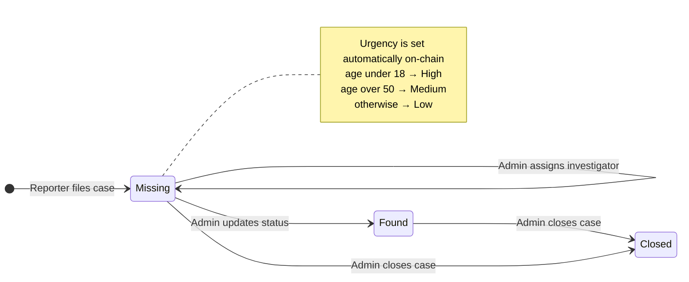
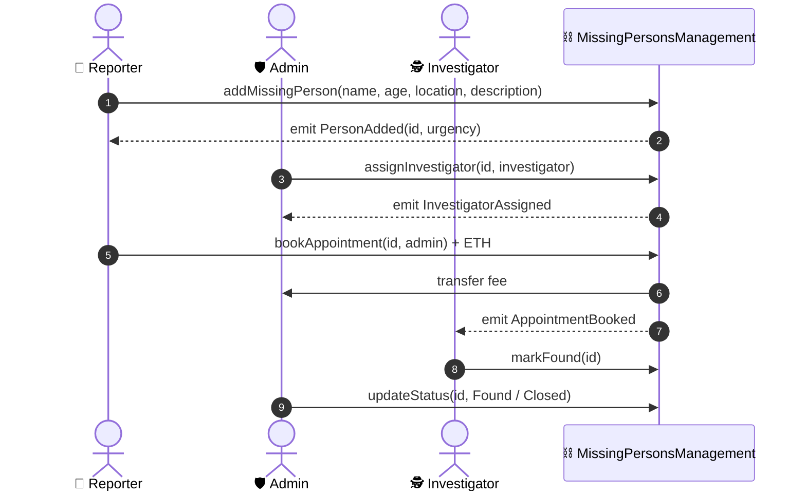

<!-- ═══════════════════════════ HEADER ═══════════════════════════ -->
<p align="center">
  
</p>

<p align="center">
  
</p>

<p align="center">
  
  
  
  
  
  
</p>

<p align="center">
  
  
  
</p>

---

## 🔎 Why a blockchain?

Missing-persons records are trusted only as far as the people who keep them. In a central database, a status can be changed quietly, a report can disappear, and an investigator assignment can be rewritten after the fact.

This DApp moves the **case ledger onto Ethereum**:

- 🧾 **Immutable history.** Every report, status change and assignment is a transaction anyone can audit.
- 🛡️ **Enforced roles.** Permissions live in the smart contract's `onlyRole` modifier, not in a server someone could bypass.
- 📡 **Events.** `PersonAdded`, `StatusUpdated`, `InvestigatorAssigned`, `AppointmentBooked` and `PersonMarkedFound` give a live, verifiable timeline of each case.

---

## 👥 Roles & permissions

<table>
  <tr>
    <th>Capability</th>
    <th align="center">🛡️ Admin</th>
    <th align="center">📝 Reporter</th>
    <th align="center">🕵️ Investigator</th>
  </tr>
  <tr><td>Register a role with a wallet</td><td align="center">deployer</td><td align="center">✅</td><td align="center">✅</td></tr>
  <tr><td>File a missing-person report</td><td align="center">—</td><td align="center">✅</td><td align="center">—</td></tr>
  <tr><td>Update case status</td><td align="center">✅</td><td align="center">—</td><td align="center">—</td></tr>
  <tr><td>Assign an investigator</td><td align="center">✅</td><td align="center">—</td><td align="center">—</td></tr>
  <tr><td>Book a paid appointment (ETH)</td><td align="center">receives fee</td><td align="center">✅</td><td align="center">—</td></tr>
  <tr><td>View appointments and mark found</td><td align="center">—</td><td align="center">—</td><td align="center">✅</td></tr>
</table>

---

## ⚙️ Case lifecycle



## 🔁 Interaction flow



---

## 🧩 Contract at a glance

```solidity
enum Role   { None, Admin, Reporter, Investigator }
enum Status { Missing, Found, Closed }

struct MissingPerson {
    uint id;  string name;  uint age;  string location;
    string description;  string urgency;      // High · Medium · Low
    Status status;  address reporter;  address investigator;
}

modifier onlyRole(Role _role) {
    require(users[msg.sender].role == _role, "Access denied");
    _;
}
```

<details>
<summary><b>📂 Project structure</b></summary>

```text
missing-persons-dapp/
├── contracts/MissingPersons.sol     the smart contract
├── build/contracts/                 compiled ABI + deployed network addresses
├── migrations/                      Truffle migration scripts
├── truffle-config.js                network configuration
├── index.html                       Tailwind dashboard (register, report, update, list)
├── app.js                           Web3.js wiring between UI, MetaMask and the contract
└── style.css
```

</details>

---

## 🚀 Run it locally

> **Prerequisites:** Node.js, [Truffle](https://archive.trufflesuite.com/), [Ganache](https://archive.trufflesuite.com/ganache/) (or any local EVM chain) and the MetaMask browser extension.

```bash
cd missing-persons-dapp-CSE-446-Project--main/missing-persons-dapp

# 1 · Start Ganache on 127.0.0.1:7545 (network id 5777)

# 2 · Add a deploy script
cat > migrations/1_deploy.js <<'EOF'
const MissingPersons = artifacts.require("MissingPersonsManagement");
module.exports = (deployer) => deployer.deploy(MissingPersons);
EOF

# 3 · Compile (solc 0.8.21) and deploy
truffle compile
truffle migrate --reset

# 4 · Serve the front end
npx serve .
```

Then connect MetaMask to the Ganache network, import a Ganache account and open the page. The account that deployed the contract becomes the **Admin**.

> 💡 `app.js` loads the ABI from `build/contracts/MissingPersons.json`, while Truffle writes `MissingPersonsManagement.json`. Point the `fetch` path at the generated file, or copy the file to the expected name.

---

<p align="center">
  <a href="https://github.com/anthonio-alex-dcosta"></a>
  <a href="https://anthonio-alex-dcosta.github.io/portfolio/"></a>
</p>

<p align="center">
  
</p>
